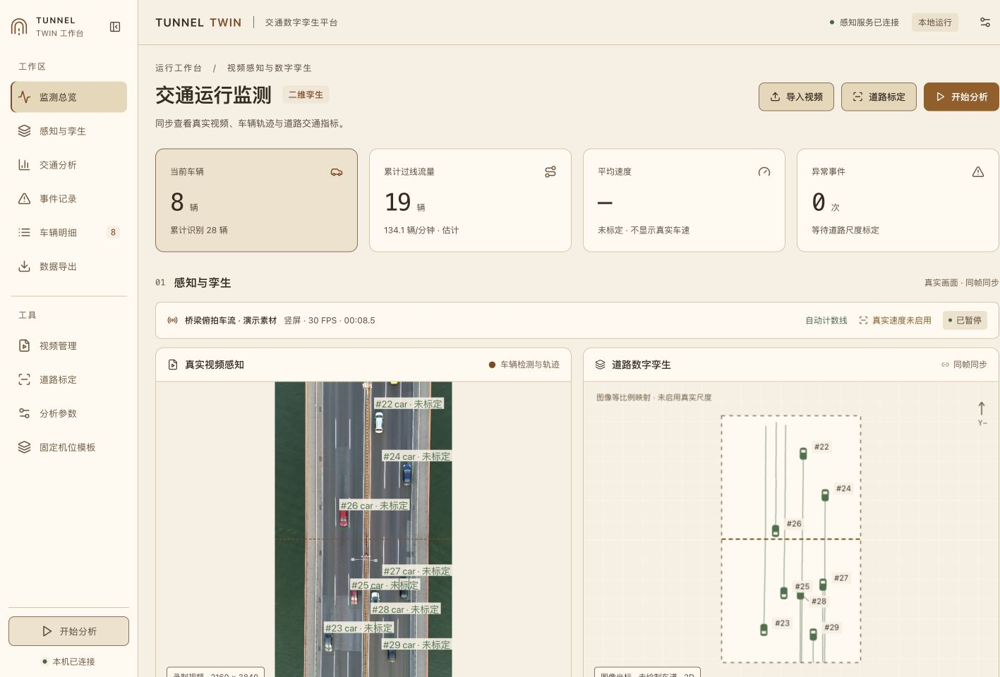

# 基于视频感知的隧道交通数字孪生系统

一个可以在 CPU 上运行的大学生竞赛演示系统。Python/FastAPI 读取真实视频，使用现成预训练模型检测车辆，使用 SORT 风格跟踪器维持车辆 ID，计算轨迹、过线流量及经实测标定后的速度，通过 WebSocket 同步 React 的真实视频与二维道路孪生。

**不需要标注或训练模型。没有真实道路尺寸时，速度、加速度和速度相关报警保持关闭。**



界面采用奶油米白、浅杏与琥珀的浅色暖调，保留交通绿色和红黄报警语义。按中文仪表盘密度适配 Linear 的表面层级、排版和间距规则；React、TypeScript、ECharts 及本地分析功能保留。统一约定见 [设计规范](DESIGN.md)，桌面、平板及手机实际截图与验证结果见 [界面检查记录](docs/linear-design/README.md)。

## Windows 10 和 Windows 11 快速启动

> **源码包说明：**包含应用源码、安装脚本、测试、示例配置和项目文档。不含模型权重、演示视频、历史分析结果、截图产物、虚拟环境或前端依赖目录。首次安装需要联网下载依赖和模型。

首次安装时，在项目根目录打开 PowerShell 并运行：

```powershell
powershell -NoProfile -ExecutionPolicy Bypass -File .\scripts\setup-windows.ps1
```

安装完成后双击 start-windows.bat。浏览器打开 http://127.0.0.1:8000，导入自己的视频后点击“开始分析”。要停止服务，在启动窗口按 Ctrl+C。逐步说明见 [Windows 启动说明 PDF](docs/Windows启动说明.pdf) 和 [可编辑 Markdown 版](docs/Windows启动说明.md)。

需要 Python 3.11 或更高版本（64 位）和 Node.js 20.19+ 或 22.12+。建议安装 Python 3.11/3.12 64 位与 Node.js LTS。CPU 可运行，首次安装会下载 PyTorch 等依赖，需预留数 GB 磁盘空间。系统会在本机处理视频，默认只监听 127.0.0.1。


导入新视频后会自动判断横竖屏并生成过线计数线，点击 **开始分析** 即可查看累计过线流量，无需先手工画线或设置真实道路尺寸。

左侧工作台导航可直接跳转 **监测总览、感知与孪生、交通分析、事件记录、车辆明细、数据导出**，随页面滚动更新当前位置；车辆明细和事件入口显示实际数量。工具区提供 **视频管理、道路标定、分析参数**，底部可直接开始或暂停分析。桌面支持收起并记住选择，平板和手机自动使用紧凑导航，短窗口中菜单可独立滚动。

**数据导出** 区可阅读当前或历史分析报告、选择统计段对照、打印/下载 HTML，以及下载车辆、交通统计、事件和车道窗口 CSV。运行明细提供 10/30/60 秒观测与预测分离的车道趋势；报警可打开保存的截图和独立原视频进行人工复核，复核记录不会改写机器测量。旧段缺少证据或来源信息时明确不可用。统计定义、文件职责及接口见 [分析与复核说明](docs/features-analysis.md)。尚未分析时提供启动入口。分析参数与道路分别提交，保存后面板保持打开并保留另一组草稿；关闭时会显示放弃未保存更改的提示。切换视频会取消原视频草稿。导航验证记录见 [工作台导航检查](docs/sidebar-navigation.md)。

固定机位可在侧栏 **固定机位模板** 命名保存已保存道路，独立叠加预览后明确应用；默认只复用图像几何并清除实际尺度，另行人工确认同机位/同视野/实测尺寸仍有效才复制尺度。详见 [固定机位模板](docs/camera-templates.md)。

当前及历史统计段提供 **人工过线 / 事件评测**，使用独立原视频、保存道路和实际观测 ID 辅助人工录入，明确完成类别后保存并评测；空系统 ID 的漏检事件保留为漏报，未核验类别与速度不会被当成零真值。标注、机器事件复核、测量数据分别保存，播放器不会改变实时分析。详见 [可视化人工评测](docs/visual-evaluation.md)。

### Windows 安装脚本会执行的步骤

setup-windows.ps1 创建独立虚拟环境，安装官方 CPU 版 PyTorch 和 requirements.txt 中的其他依赖，下载并校验 models.json 中的预训练权重，再安装前端依赖并构建页面。锁定文件 requirements-locked-macos-py313.txt 仅适用于 macOS arm64 / Python 3.13，不要在 Windows 上使用。首次安装需联网；接收者需另外提供视频。

也可以将视频复制到项目目录并准备为默认演示：

```powershell
.\.venv\Scripts\python.exe scripts\prepare_demo.py --video "D:\Videos\traffic.mp4"
```

## 提供的视频与模型选择

原视频为 H.264 MP4，2160×3840，30 FPS，共 256 帧，时长 8.53 秒，约 47 MB。画面是双向桥梁车流俯拍，并非隧道内部。系统可以验证道路车辆感知和孪生同步，隧道场景的检测表现需要另用隧道素材评估。

实际比较发现，通用 COCO SSD、COCO YOLO11n/11s 和 Faster R-CNN MobileNet 在该垂直俯拍素材上出现明显漏检或误分类。按任务允许的“实测后选择更稳定的现成模型”，本视频默认使用 **VisDrone YOLO11n 航拍预训练权重**。这是作者已经训练并发布的模型，**并非本项目训练，也不是纯 COCO 权重**。本项目没有进行 fine-tuning。

系统保留三种预训练模型，可在 **道路标定 → 分析参数 → 预训练模型** 中切换：

| 配置名 | 训练数据/来源 | 用途 |
| --- | --- | --- |
| `visdrone_yolo11n` | [dronefreak 发布的 VisDrone YOLO11n](https://huggingface.co/dronefreak/visdrone-yolo11n) | 当前俯拍视频默认选项 |
| `coco_yolo11n` | [Ultralytics 官方 COCO YOLO11n](https://docs.ultralytics.com/models/yolo11/) | 普通道路视角，需按新视频验证 |
| `ssdlite320_mobilenet_v3_large` | [Torchvision 官方 COCO SSD MobileNetV3](https://docs.pytorch.org/vision/stable/models/generated/torchvision.models.detection.ssdlite320_mobilenet_v3_large.html) | COCO 轻量基线，网络内部固定 320 输入 |

权重来源、许可证和 SHA-256 记录在 `models.json`，`scripts/download_models.py` 负责下载与校验。三种模型加载前也会校验本地文件摘要，缺失或损坏时明确报错；分析阶段不会自动下载替代权重。航拍模型原始类别中的 `van` 归入 `car`，`motor` 归入 `motorcycle`；`truck`、`bus` 单独保留，其余类别过滤。类别和置信度来自模型推理，不由车辆大小猜测。

YOLO 权重及其实现遵循 AGPL-3.0；VisDrone 作者还列明非商业研究的数据条件，详见模型卡。Torchvision 实现遵循 BSD-3-Clause。比赛材料应注明模型及数据来源，本项目的工作重点是系统集成、标定、分析与同步，不应将现成检测网络声称为自研算法。

## 整体架构

```text
VideoReader → Pretrained Detector → SORT Tracker
                 ↓                      ↓
           car/truck/bus/motorcycle     稳定 ID + 路面接触点
                                        ↓
                            Homography / 世界坐标（米）
                                        ↓
                     速度平滑 / 车道归属 / 过线统计 / 异常规则
                                        ↓
                         同帧 JPEG + 车辆结构 + 统计数据
                                        ↓
                               FastAPI WebSocket
                                        ↓
               React 视频画布 + 二维孪生 + ECharts + 事件日志
                                        ↓
                            vehicles / statistics / events CSV
```

文件职责：

```text
backend/
  main.py                  REST、上传、WebSocket、前端静态文件
  service.py               视频会话、播放控制、线程互斥
  processor.py             逐帧分析与同帧状态打包
  vision/
    video_reader.py        视频读取、缩放、时间轴、RTSP 读取接口
    detector.py            三种预训练检测适配器、分块与 NMS
    tracker.py             Kalman 预测 + Hungarian 匹配
  calibration/homography.py
  traffic/
    vehicle_state.py       每车状态与 100 点轨迹
    speed_estimator.py     窗口拟合速度与移动平均
    flow_counter.py        有限线段穿越与单 ID 去重
    lane_detector.py       多边形车道
    traffic_metrics.py     车道、流量、密度估计
  events/rules.py           停车、急减速、逆行规则
  api/schemas.py            请求及几何参数校验
  security.py              来源/Host 边界与流式上传体积限制
  evaluation.py            人工真值对照与误差/覆盖率评估
  exporter.py              三种 CSV、稳定快照和统计段元数据
  data/
    videos/                导入的视频
    models/                预训练权重
    calibrations/          按视频内容哈希保存的标定和道路配置
    runs/<run_id>/         每次分析段的 CSV 和 run.json
frontend/src/
  components/              VideoView、DigitalTwin、Dashboard、Charts、
                           CalibrationPanel、EventPanel
  types/                   共享的数据结构定义
scripts/                   安装、权重准备、离线分析、回归检查
tests/                     几何/跟踪/规则/HTTP/WebSocket 测试
config.yaml                默认参数
examples/demo_scene.json   给定桥梁素材的图像车道和计数线
```

## 检测、跟踪与轨迹

检测器输入缩放后的真实视频帧，返回车辆类别、置信度与矩形框，并用非极大值抑制消除重复框。默认最长边缩放至 960 像素，YOLO 输入大小为 960；SSD 内部输入固定 320。配置可启用重叠分块检测。所有框及路面位置在分析前通过 `source_width/display_width` 和 `source_height/display_height` 换算回**原视频像素**，不会把缩放图坐标当作原始坐标。

跟踪器采用 SORT 风格实现：每车一个八维常速度 Kalman 状态（中心、宽高及对应变化率），在每帧预测位置；检测帧使用带 IoU 门限的 Hungarian 匹配校正状态。匹配成功时沿用 ID，连续两次观测确认车辆，短暂漏检保留轨迹。默认每隔两帧检测一次，中间帧由 Kalman 预测；界面及 CSV 会区分观测位置与预测位置。过线、测速和报警只使用实际检测校正后的观测点。

`max_age` 控制保留未匹配车辆的时间。过久未匹配后删除该跟踪对象；重新进入画面的车可能获得新 ID。该版本不具备跨摄像机身份识别，严重遮挡仍可能切换 ID，“累计识别”是已确认轨迹 ID 数量，不能当作人工核验后的独立物理车辆总量。

道路位置使用框的**底边中心点** `((x1+x2)/2, y2)`，不使用框中心。每车保存最近 100 个像素轨迹点和世界轨迹点，前后端同步显示。车辆朝向取最近轨迹的 `atan2(Δy, Δx)`，孪生图标按此旋转。未经标定的孪生视图按原视频像素比例等比例缩放并居中，横向、纵向或斜向车道保持原画面方向，车辆、轨迹、车道和计数线共用同一映射，不用于测量真实距离。未绘制车道时仅显示图像范围与车辆，不生成默认道路或车道分隔线；可在“道路标定”中绘制实际车道轮廓。标定后的世界视图按米坐标等比例绘制，并根据标定角点调整显示方向，车道箭头、车辆朝向与 Y 轴提示同步变换。

本机已导入的横屏素材 `13454593_3840_2160_60fps.mp4` 已按画面手工配置四条机动车道，上方两条向左、下方两条向右，保存为 `backend/data/calibrations/50402aaca3607bdc2042a455-scene.json`。这些轮廓是图像预设，可在“道路标定”中调整；未设置真实米尺度。方向修复的检查记录及对照截图见 [孪生道路检查](docs/twin-orientation.md)。

## 道路尺度标定和正确测速

1. 导入视频，暂停在道路清晰的帧，点击 **道路标定**。
2. 选择 **绘制 4 个标定点**，按 **左上 → 右上 → 右下 → 左下** 点击道路同一平面上实际矩形区域的角点。
3. 输入这个矩形的**实际宽度和实际长度（米）**。尺寸应来自测量、测绘或可靠道路资料，不能为了得到某个车速随意填写。
4. 点击 **保存道路配置**，然后 **重新分析** 或 **开始分析**。
5. 在标定区域内获得足够观测点后显示 km/h；区域外车辆不外推真实车速。

界面坐标自动换算为原视频坐标。四点凸性、退化、重复点、越界与无效尺寸会被拒绝。每个视频用文件内容哈希识别，同一视频改名或重新上传仍可读取已有配置。

Homography 通过 `cv2.getPerspectiveTransform` 将原图四角映射到 `[(0,0),(width,0),(width,length),(0,length)]`，`cv2.perspectiveTransform` 将每个接触点换算为道路平面上的米坐标。存在透视时，画面不同位置的“米/像素”不同，因此不能直接把像素位移乘一个比例变成 km/h。

视频时间读取解码器实际 PTS，而非用帧号除以平均 FPS。定位用帧索引探测实际 PTS，选择首个不早于目标时刻的帧，避免 OpenCV 按平均帧率定位 VFR 片段；导入时尝试读取最后一帧 PTS 推算末端时间（最后一帧时长按名义 FPS 近似），无法探测时元数据 `duration_estimated=true`。不提供有效单调 PTS 的输入会报错并提示转换恒定帧率 MP4。速度以最近 N 个**检测观测点**和视频时间做线性最小二乘拟合得到 `(vx,vy)`，再对最近三次速度做移动平均；`sqrt(vx²+vy²) × 3.6` 得到 km/h。默认 N=10，至少 5 个观测点、跨度至少 0.1 秒才显示数值。加速度以平滑速度的 m/s 值对视频时间求差，单位 m/s²。暂停、0.5×/2× 播放不会改变测量值，因为算法使用**视频时间**，不是电脑处理时间。

参数保存在 `backend/data/calibrations/<video_hash>-calibration.json`；最近保存的实测标定另写入 `backend/data/calibration.json`。道路车道与计数线保存在同目录的 `<video_hash>-scene.json`。未标定时 CSV 中世界位置、速度和加速度留空，页面显示“未标定”，不会使用默认 50m/12m 生成看似真实的数字。

几何前提是固定或稳定摄像机、近似平坦道路。镜头明显移动或道路坡度显著时，需要先稳像或增加相机/道路模型；当前系统不会自动补偿相机运动。这个系统用于实验演示，其速度不是法定测速设备输出。

## 计数线、车道与交通参数

上传、路径导入或首次选择视频时，系统读取实际宽高，自动在画面中点生成计数线：横屏（宽大于高）生成竖线，竖屏（高大于宽）生成横线，方形默认横线。已有车道轮廓时线段覆盖这些车道，否则覆盖画面。视频和孪生同步显示该线，点击 **开始分析** 后统计累计过线车辆和流率，无需先标定真实尺寸。自动计数线根据画面宽高生成，不自动识别道路语义；道路走向与画面方向不同、镜头倾斜时应调整计数线。

在标定面板选择 **绘制计数线**，点击有限线段的两个端点并保存，可替换自动线；也可以 **清除计数线** 后保存以关闭计数，或点击 **恢复自动计数线** 再保存。自动、手动或关闭的状态按视频内容保存，重新选择同一视频时保留；已有手工计数线不会被覆盖，旧配置中未设置计数线的视频会自动补充。

车辆的前后观测点组成运动线段，与计数线真正相交才计数，双向穿线均统计，在线段无限延长线上经过不会误计；同一 ID 即使再次穿线也只计数一次。车辆已在计数线上出现在视频第一帧时，不补算未知的过线过程。自动线验证截图见 [自动过线检查](docs/automatic-flow.md)。

选择 **绘制新车道**，依次点击不少于三个凸多边形顶点，点击 **完成**，填写车道名及合法方向。支持每车道 `↑ −Y / ↓ +Y / → +X / ← −X`；标定后方向基于世界坐标，适合双向道路分别设置。车道多边形以原图保存，车辆接触点归属检测与道路平面 Homography 下的多边形归属一致。给定演示视频的六条图像车道与横向计数线是便于启动的人工图像预设，可修改，并不提供实际米尺度。

页面显示当前车辆、累计确认 ID、累计过线数、平均/最大/最小车速、异常事件数、分类分车道流量、分车道平均速度，以及以下有条件指标：

| 指标 | 计算与限制 |
| --- | --- |
| 辆/分钟 | 最近 60 秒过线数；不足 60 秒时按实际分析时长折算，并标记“估计” |
| 辆/小时 | 观察满 60 秒后按最近一分钟折算，仍是小时流率估计，不是实际累计小时数量 |
| 区域密度估计 | 标定区域车辆数 / 标定道路长度（km），跨全部车道；不是全隧道密度 |
| 平均过线时距 | 计数线连续事件时间差的平均值，汇总所有方向与车道；不是同车道跟车安全时距 |
| 时间占有率 | 没有定义检测区域驻留观测，因此关闭 |

8.53 秒短视频的每分钟流率外推波动很大，不能作为长期交通负荷结论。ECharts 显示累计流量、平均车速、当前车辆数随视频时间的曲线，以及当前车辆类型分布，均来自实际分析结果。

## 异常规则

只在已标定、有效世界位置和充分速度观测时运行，规则参数可在界面修改：

- **异常停车**：平滑车速小于 3 km/h，持续超过 3 秒触发 `ABNORMAL STOP`；移动后重置计时。
- **急减速**：在至少 0.5 秒的速度跨度内计算加速度，小于 −4 m/s² 触发 `HARD BRAKING`，不直接用单帧速度抖动报警。
- **逆行**：最近至少 0.7 秒、按实际检测间隔扩展以包含有效观测点的轨迹方向与所在车道合法向量的余弦小于 −0.6，且车速大于停车阈值、持续至少 1 秒，触发 `WRONG WAY`。

同一车辆同一种报警默认冷却 5 秒。视频框和孪生车辆同时变红并显示警告，事件面板记录视频时间、ID、类型、车道和车速，写入 `events.csv`。这些是可解释的轨迹规则，不是训练出来的异常模型，阈值应结合镜头和道路调整。当前短视频没有实测标定，因此不声称其中发生了异常；规则功能通过可控轨迹回归测试验证。

## 播放、同步与数据段

支持上传、选择已导入视频、输入本机文件路径、播放、暂停、重新分析、拖动时间轴和 0.5×/1×/2×。暂停继续会保留同一段的 ID、计数和 CSV。**拖动、切换视频、重新分析、保存道路配置或应用分析参数会重建统计段**，避免拖动后把未来轨迹和报警混入过去；旧 CSV 始终保留。页面底部显示当前统计段起点。

WebSocket 每次传递一个分析快照，包含 `frame`、`timestamp`、该帧 JPEG、检测车辆、世界/像素轨迹、统计和事件。前端只接收更新的会话/revision，JPEG 解码完成后连同原帧的车辆状态一起提交；视频与孪生共用这份显示快照。道路草稿绑定视频 token 与道路修订号，后端拒绝旧视频或被其他窗口更新的道路配置（HTTP 409）。CPU 性能不足时播放会放慢以保留分析帧，不跳帧冒充实时；播放倍速是目标速率，上限受本机推理性能限制。处理 FPS 为最近 30 帧的算法吞吐，与原视频 30 FPS、浏览器渲染帧率不同。

默认后端只监听 127.0.0.1，为本机演示服务。当前是单分析会话，多浏览器看到相同状态，不支持多人独立视频任务。HTTP 修改操作检查浏览器 Origin，WebSocket 拒绝缺失/非可信 Origin；允许服务同源以及 localhost/127.0.0.1 的 Vite 5173 开发来源，额外可信来源可用 `TWIN_ALLOWED_ORIGINS` 逗号分隔设置。Host 仅接受本机地址。这些是本机浏览器边界保护，尚无多人认证或公网部署支持。命令行 WebSocket 客户端须主动发送对应服务 Origin；普通本机 CLI HTTP 请求可不带 Origin。上传在 multipart 接收阶段限制请求体（2 GB 视频加 1 MB 表单开销），并继续校验最终文件大小。`VideoReader` 已保留 RTSP/RTSPS 流读取接口，但本版页面和会话控制以录制视频为准，未提供实时流配置、认证、断线重连或上线验收。

## CSV 导出与离线分析

分析时逐帧写入并刷新 `backend/data/runs/<run_id>/`，下载先在写入锁内创建稳定副本，发送后删除临时文件。同目录 `run.json` 保存视频哈希、开始/结束时间、参数、道路配置和是否标定。历史入口兼容旧 CSV，但旧段缺少的来源和起点会显示未记录。页面底部可直接下载：

| 文件 | 字段 |
| --- | --- |
| `vehicles.csv` | timestamp, frame, vehicle_id, vehicle_type, confidence, lane, x_pixel, y_pixel, x, y, speed, acceleration, status, observed |
| `traffic_statistics.csv` | timestamp, vehicle_count, total_vehicles, average_speed, max_speed, min_speed, flow, flow_per_min, flow_estimated, density, density_estimated |
| `events.csv` | timestamp, vehicle_id, event, lane, speed |

`timestamp` 是视频秒数，`x/y` 是米，`x_pixel/y_pixel` 是原图像素，`speed` 是 km/h，`acceleration` 是 m/s²。`observed=False` 标记 Kalman 预测帧；测速、计数和报警不会把该帧当成新的检测观测。CSV 使用 UTF-8 BOM，便于 Excel 打开中文。无事件时 `events.csv` 仍含正确表头。

无需打开页面的离线分析：

```bash
.venv\Scripts\python.exe scripts/analyze.py --video "/path/to/your/video.mp4"
# 使用新视频和已实测标定的 JSON
.venv\Scripts\python.exe scripts/analyze.py --video /path/to/video.mp4 --calibration /path/to/calibration.json --scene /path/to/scene.json
```

## 前后端分别启动

开发模式：

```bash
# PowerShell 终端一：
.\.venv\Scripts\python.exe -m uvicorn backend.main:app --host 127.0.0.1 --port 8000

# PowerShell 终端二：
Set-Location frontend; npm run dev
# 页面：http://127.0.0.1:5173，API/WS 代理到 8000
```

分别启动后端和前端：

```bash
# 终端 1，在项目根目录
.venv\Scripts\python.exe -m uvicorn backend.main:app --host 127.0.0.1 --port 8000
# 终端 2
cd frontend
npm run dev
```

部署演示采用 `npm run build` 后由 FastAPI 直接提供 `frontend/dist`，因此 `.\start-windows.bat` 只启动一个进程。修改前端后需重新构建并刷新浏览器；修改 Python 或 `config.yaml` 后需重启后端。API 说明在 <http://127.0.0.1:8000/docs>。

## CPU / NVIDIA GPU 与配置

`config.yaml` 的 `detector.device: auto` 会在 PyTorch 能使用 CUDA 时启用 NVIDIA GPU，否则 CPU。CPU 无需任何 NVIDIA 驱动。本机已验证 CPU；没有在 NVIDIA 设备上实测。使用 GPU 时安装适配显卡驱动的 [PyTorch 官方 CUDA 版本](https://pytorch.org/get-started/locally/)，可用 `.venv\Scripts\python.exe -c "import torch; print(torch.cuda.is_available())"` 检查。也可显式配置 `cpu` 或 `cuda`，无可用 CUDA 时自动退回 CPU。

默认参数包含置信度 0.4、输入 960、4 个 CPU 线程、检测间隔 2 帧、跟踪保留 30 帧、速度窗口 10 个检测点和上述事件阈值。界面调整在本次后端会话生效；长期默认值请修改 `config.yaml`。模型内部尺度和显示尺度分开处理。较弱 CPU 可降低 `detector.input_size`、`video.display_max_side` 或增大检测间隔；降低分辨率可能漏检小车，必须重新验证效果。

## 运行验证

```bash
.venv\Scripts\python.exe -m pytest -q
npm --prefix frontend test
.venv\Scripts\python.exe scripts/smoke_video.py
.venv\Scripts\python.exe scripts/check_runtime.py
.venv\Scripts\python.exe scripts/lock_dependencies.py --check
Push-Location frontend; npm run build; Pop-Location
```

自动化回归覆盖几何、跟踪、计数、标定测速、异常规则、API、上传、配置冲突、播放状态、稳定 CSV 下载，以及人工真值评估的匹配、覆盖率和非法输入。前端测试覆盖原有几何、网络快照顺序、会话重启、图像/状态成对提交、绘制末点去重和实际 VideoView 绘制行为。详细的历史测试数量和运行证据属于原工作区内部记录，未纳入源码分享包；本包制作时没有重新运行测试。后端自动化测试、运行检查与默认 smoke 使用临时数据目录；不会把测试 CSV、标定或模型配置写入用户数据。可用 `$env:TWIN_DATA_DIR = "D:\twin-data"` 显式指定另一套数据（需自行准备 videos/models）。

新的真实素材 CPU smoke 记录于 [review-smoke-2026-10-02.json](docs/review-smoke-2026-10-02.json)。默认 smoke 仅打印结果，`--output` 可保存指定记录，不覆盖旧 `TEST_REPORT.json`。本次 256 帧通过，最多同时 13 辆、28 个确认 ID、19 次测试线穿越，未标定的速度/加速度/世界坐标与报警保持关闭。该次离线吞吐 42.5 FPS，为并行回归期间的一次本机测量，未做严格性能对照。

初版原视频完整 CPU smoke 测试记录于 `TEST_REPORT.json`：256 帧均完成，最多 13 辆同时活动，28 个确认轨迹 ID，最长 ID 保持 136 帧，平均相邻帧 ID 保留率 98.9%，测试计数线得到 19 次穿越，离线吞吐约 39.9 FPS。ID 保留率是运行连续性指标，**不是有标注的跟踪准确率或 ID-switch 评测**；测试线计数也未经人工逐车核验。真实模型四秒抽查帧检出 10 辆车。

另通过真实 Uvicorn HTTP/WebSocket 连接与空闲连接断开后的正常退出检查，命令为 `.venv\Scripts\python.exe scripts/check_runtime.py`（自动分配 localhost 临时端口，生成隔离合成视频，不依赖用户演示文件）。

浏览器已经实际打开并验证开始/暂停、车辆表格、四点采集、同步孪生、图表与道路配置面板，截图见 `docs/system-preview.jpg`。本次没有真实道路尺寸，因此没有把演示视频产生的任何数值声称为实测车速。需要实际标定、更长视频及多种天气/隧道光照样本，才能进一步评估测速误差、分类精度和报警误报率。

## 人工真值准确性评估

新增 `scripts/evaluate.py` 对照经人工核验的计数、速度和报警标注，检查视频哈希及核验区间，输出计数绝对误差、速度覆盖率/MAE/RMSE、报警 TP/FP/FN/precision/recall。模板默认未核验，不能直接作为真值使用。准备、命令和指标边界见 [准确性评估流程](docs/accuracy-evaluation.md)。当前缺少真实隧道样本、实测尺度及人工真值，因此没有新准确率或测速精度结论；检测 mAP 与 MOT 评测仍需逐帧框/物理 ID 标注和对应导出。

## 常见问题

- **端口被占用**：先停止旧服务，或 `$env:TWIN_PORT = "8001"; .\start-windows.bat` 后访问 8001。开发前端的代理默认仍是 8000。
- **权重缺失**：运行 `.venv\Scripts\python.exe scripts/download_models.py`；不会触发模型训练。校验失败时核对来源，脚本不会加载未通过校验的文件。
- **新视频没有车辆**：切换适合镜头的预训练模型，查看置信度与输入尺寸；极端视角、遮挡或很小的车辆仍可能漏检。
- **始终没有 km/h**：确认四个点、实际尺寸已保存，车辆位于标定区域内，并连续取得不少于五个检测观测点。
- **双向道路被误报逆行**：为上下行分别画车道并设置不同合法方向。
- **拖动后流量归零**：这是新的统计段，旧段的 CSV 保留在 runs 目录。
- **前端连接不上**：先确认 `/api/health` 可访问；开发模式确认后端 8000 与 Vite 5173 都已启动。
