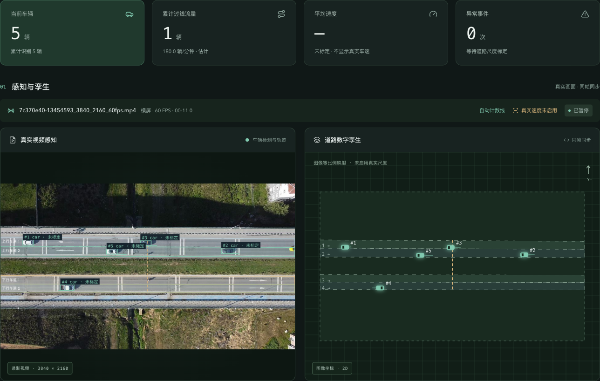
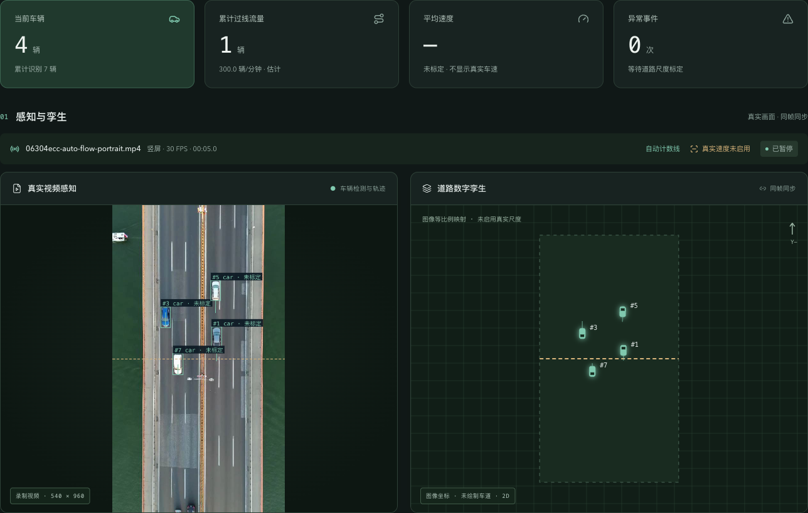

# 自动过线计数检查

日期：2026-10-01。

## 使用方式

导入/上传新视频后，系统读取视频实际宽高，横屏生成竖向计数线，竖屏生成横向计数线，方形默认横向线。计数线位于画面中点；已配置车道时覆盖所有车道的横向范围，否则覆盖画面。点击“开始分析”后，实际车辆轨迹穿线会更新累计过线流量、每分钟流量、曲线与 CSV，无需真实尺度标定。

计数线和模式按视频内容哈希保存。旧配置已有手工线时保留，旧配置缺少线时生成自动线。“道路标定”中可以手绘替换、清除后关闭，或恢复自动线，再保存。主动关闭后重新选择视频不会重建。

这里按画面宽高选择默认线，不自动识别道路语义；斜拍或道路走向与画面方向不同的镜头，应手动调整。车辆双向穿线均计数，同一 ID 每个统计段只计一次；该 ID 在首个观测点就已在线上时不会补算未知历史。

## 自动化验证

- `.venv/bin/python -m pytest -q`：39 项通过，新增横/竖/方形自动线、所有车道范围、边界限制、双向计数和去重；覆盖上传/路径导入、自动保存与重新选择、旧配置迁移和手动/关闭/恢复状态。横/竖两种可控车辆轨迹均实际产生 WebSocket 流量与 CSV 记录，未标定速度保持空值。
- `npm --prefix frontend test`：8 项几何测试通过。
- `npm --prefix frontend run build`：TypeScript 和 Vite 构建通过，保留原有 ECharts 分包大小提示。
- `.venv/bin/python scripts/check_runtime.py`：真实 HTTP、空闲 WebSocket、断开与服务正常退出通过。

## 真实页面验证

- 横屏原始视频 `7c370e40-13454593_3840_2160_60fps.mp4`：自动竖线为 `(1920,696) → (1920,1422)`，覆盖四条已配置车道；第 20 帧快照累计过线流量为 1，车辆和线在真实画面及孪生中同步显示。
- 从原有竖屏实拍素材生成 540×960、5 秒的验证片段，并通过实际路径导入接口作为新视频导入：自动横线为 `(0,480) → (540,480)`；第 6 帧快照累计过线流量为 1。该临时视频及场景配置已清理。
- 在实际标定面板点击“清除计数线”并保存，页面显示“过线计数已关闭”；再次点击“恢复自动计数线”并保存，恢复自动线状态。
- 320px 页面没有整体横向溢出；横竖屏信息、自动计数状态与播放状态可显示。

以上实际计数用于功能验证，没有逐车人工核对以声明计数准确率。截图中的每分钟流率因观察不足 60 秒而标记为估计。

