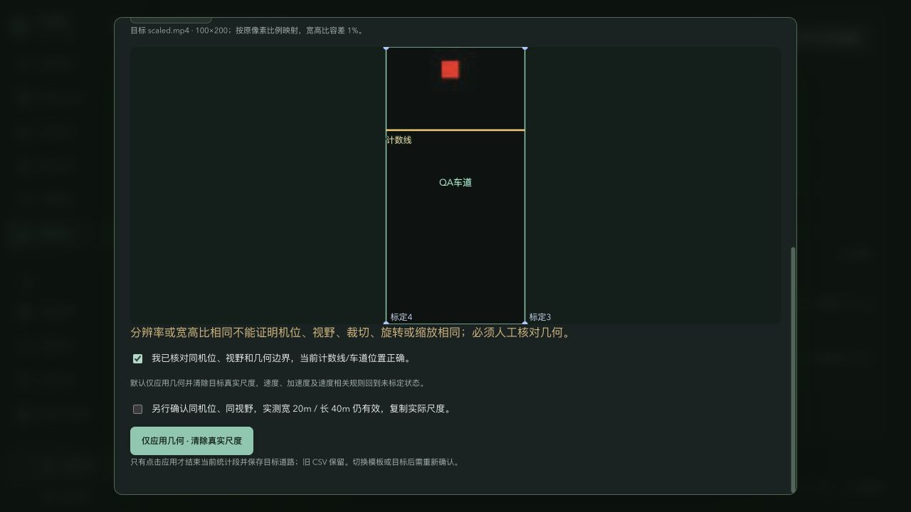
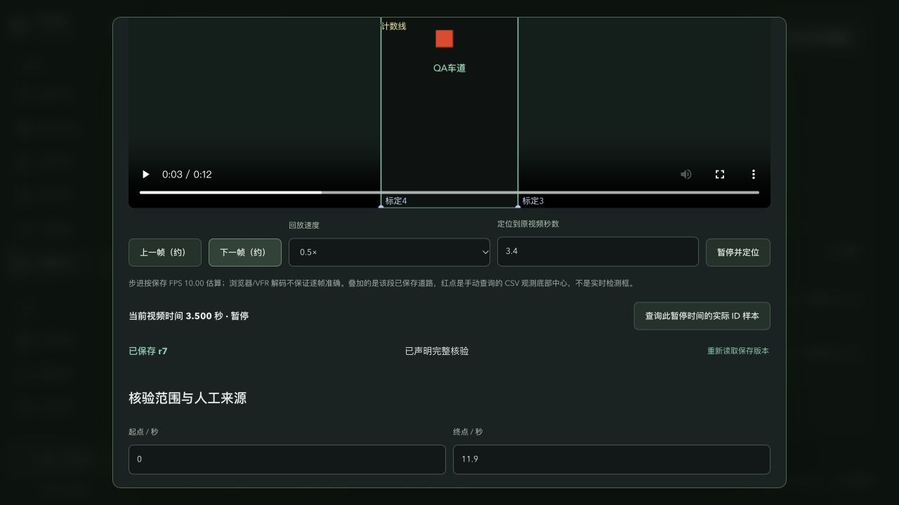
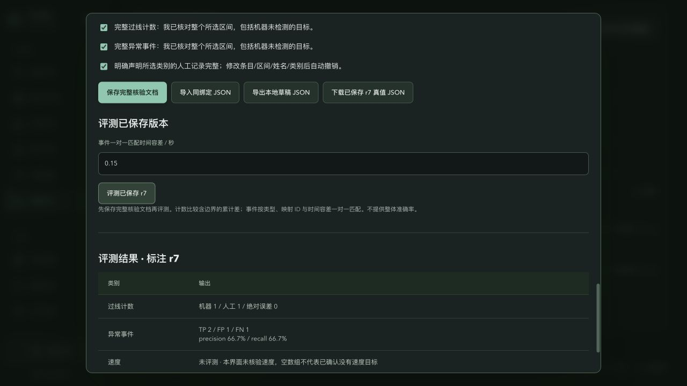
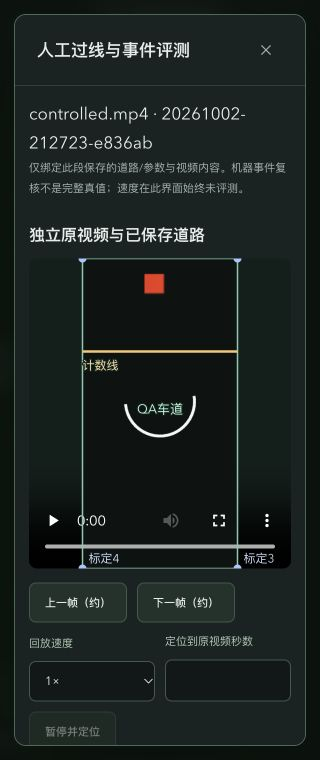
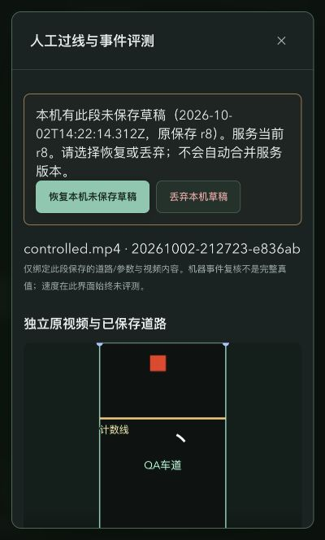

# 固定机位模板与可视化人工评测验收

2026-10-02。用户授权实现并要求主审自己测试；所有功能测试数据位于隔离临时 DATA，未把测试机位尺度写入用户真实录像配置。

## 已实际验证

- 基线 75 个后端测试通过；新增实现首轮 87 个后端、24 个前端测试通过。最终补强后数量与构建证据见下方交付记录。
- 主审独立接口测试 22 项通过：[记录](002-stage2-api-verification.json)。覆盖命名唯一、版本冲突、同比例坐标、默认清尺度、独立尺度确认、保存/重启、未核验拒绝评测、计数和事件、部分类别、实时状态与机器 CSV 不变。
- 主审额外 6 项边界测试通过：[记录](002-stage2-edge-verification.json)。公共 schema2 评测入口拒绝错误尺寸；所评事件 CSV 零字节/错表头/NaN/零 ID 均拒绝；下载检查 revision；旧段来源丢失仍可编辑已保存来源事实绑定的草稿，拒绝新的完整声明；布尔时间拒绝；机器 CSV 未改。
- 真实桥梁演示录像实际检测 256 帧、19 次机器过线；未标定世界坐标、速度和加速度为空，0 条速度相关报警：[记录](002-real-video-verification.json)。这是运行回归，不能解释为真实精度结论。
- 受控真实视频帧经过现有跟踪、标定与规则产生 1 次过线、3 条机器事件。浏览器人工独立录入 1 次过线、2 条映射事件、1 条无轨迹映射的漏检测试事件，保存 r7 并评测，显示计数绝对误差 0、TP 2 / FP 1 / FN 1。速度未评测，未映射事件计入 FN。实际下载 JSON 与界面一致：[下载结果副本](002-browser-result.json)。测试人工事件包括刻意构造边界样例，不是科学真值研究。
- 浏览器操作模板保存、改名、选择、独立叠加预览与应用：200×400 → 100×200，计数线 y120 → y60；几何应用清空尺度，单独确认才复制受控录像已知20×40m尺度；演示素材比例差异超过1%时拒绝应用。
- 浏览器操作草稿记录、编辑、保存、关闭、重新打开；修改撤销核验、旧结果标记过期、未保存关闭弹出保留/放弃选择；过线和事件支持独立编辑/删除。
- 独立播放器原视频加载尺寸200×400，3.4s下一帧近似步进到3.5s，回放倍率0.5；暂停查询得到观测ID1，timestamp3.4s，pixel92.5/166.4。叠加按contain居中，与黑边/原画面像素比例一致。
- 历史播放器定位1.9s，后台当前分析继续从9.3s至11.9s正常完成，未跳转或关闭当前段。
- 320px：文档scrollWidth320、弹窗client/scroll290；390px：文档scrollWidth390、弹窗client/scroll360。两种弹窗无页面横向溢出；Escape关闭恢复模板入口焦点；页面控制台error/warn为空。

## 冷审发现并修复

实现阶段补强公共维度绑定、损坏所评CSV校验、部分评测只读所需CSV、旧来源事实持久化、下载版本校验、模板提交锁与普通道路编辑清除旧来源声明。前端补查暂停采样迟到响应、导入后分页、严格导入类型。

最终冷审发现并修复首尾非整数PTS被显示舍入后越界、异步File.text旧导入覆盖新输入、未保存草稿刷新丢失。主审实际处理器复测首帧1/30秒记录成功，保留原值；File.text后选B先完成、旧A后完成，仅提交B。27个前端回归通过。

实际刷新尝试被未保存离开保护拦下；关闭并重新打开页面后，出现显式恢复/丢弃选择。主审恢复未保存备注、时间字段空字符串及待录入车辆说明，三项均保留，完整核验声明撤销。补全输入并保存r8后，重开恢复提示消失。恢复尚未选择时，保存、导入、评测isEnabled均false，无法隐式覆盖本机草稿。跨run JSON在页面被拒绝且旧文档保留；同绑定JSON导入成功，完整声明撤销。实际删除第3事件后显示2条，放弃未保存更改保留服务版本。最后页面控制台error/warn为空。

最终独立冷审PASS，无剩余已确认缺陷；一项基于绕过禁用fieldset直接调用保存处理器的疑似缺陷经最新源码和真实UI核对后撤回。

## 最终交付

主审最终独立 `TWIN_DATA_DIR=/private/tmp/twin-stage2-final-test .venv/bin/python -m pytest -q`：88 passed in9.38s；前端27 passed；生产tsc/Vite构建PASS（index-CwGdHUmc.js，既存ECharts大块提示）；`check_runtime.py` HTTP、可信来源WebSocket、正常关闭、隔离DATA通过；git diff --check通过。原138基线源文件无漂移。源文件、测试、中文文档与生产构建交付信息见清单；用户原视频、配置、运行数据与模型不从测试环境复制。

## 界面证据

最终交付：23源码/测试/中文文档文件（11替换、12新增）+5生产构建文件全部与已审版SHA256一致：[清单与恢复映射](002-delivery-manifest.json)。原backend/data117文件在拷回前后及正式只读验收后逐文件SHA256相同。备份位于 `/private/tmp/twin-stage2-delivery-backup-4e_rirsv`，包含11被替换原文件与整个原dist。

原项目 `./start.sh` 启动 `http://127.0.0.1:8000/` 成功；正式页面能打开空模板列表与已有历史demo运行人工编辑，原视频、6车道叠加与0→8.5秒区间加载，控制台无error/warn。只读验收没有新建标注文件或修改用户运行/配置。隔离8003已停止，临时测试标签已关闭；正式8000和交付标签保留。
